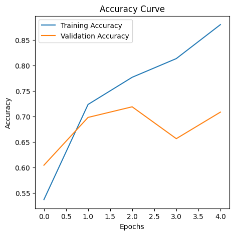
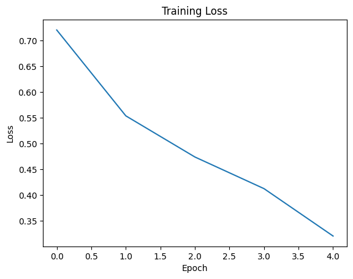
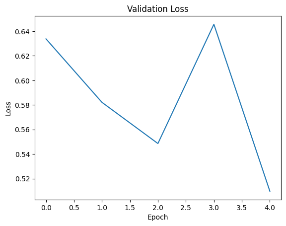
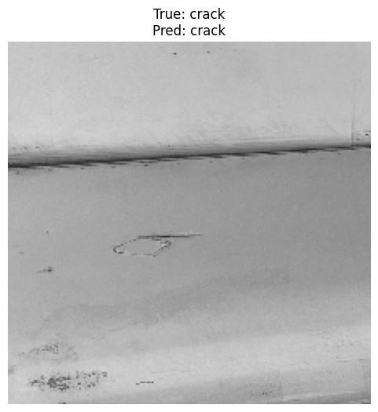
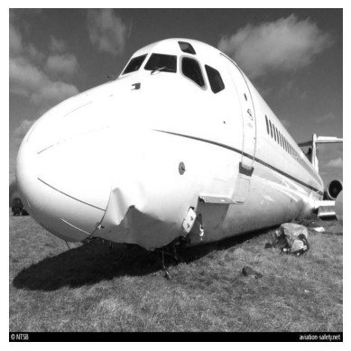

<div align="center">

# ✈️ Aircraft Damage Classification & Captioning

### Clasificación de daños en aeronaves con VGG16 y descripción de imágenes con BLIP


*Proyecto final del **IBM AI Engineering Professional Certificate***

</div>

---

## 📑 Contenido

- [🎯 Objetivo](#-objetivo)
- [📊 Dataset](#-dataset)
- [🧠 Qué hace el proyecto](#-qué-hace-el-proyecto)
- [🔧 Parte 1: Clasificación con VGG16](#-parte-1-clasificación-con-vgg16)
- [🗣️ Parte 2: Descripciones con BLIP](#️-parte-2-descripciones-con-blip)
- [🔍 Análisis honesto de los resultados](#-análisis-honesto-de-los-resultados)
- [🚀 Cómo ejecutarlo](#-cómo-ejecutarlo)
- [🛠️ Próximos pasos](#️-próximos-pasos)
- [📚 Qué aprendí](#-qué-aprendí)
- [👤 Autor](#-autor)

---

## 🎯 Objetivo

La inspección manual de aeronaves es lenta y propensa a errores humanos. Este proyecto explora cómo **automatizar parte del proceso** con dos modelos preentrenados:

1. 🔎 **Clasificar** una imagen de daño en una aeronave como **abolladura (`dent`)** o **grieta (`crack`)**, usando *transfer learning* con **VGG16**.
2. 📝 **Describir** la imagen en lenguaje natural (descripción corta y resumen) con el modelo **BLIP** de Hugging Face.

## 📊 Dataset

- 🛩️ **Aircraft Damage Dataset** (Roboflow), licencia **CC BY 4.0**, publicado por el usuario *Youssef Donia*.
- 🔗 [Fuente original en Roboflow](https://universe.roboflow.com/youssef-donia-fhktl/aircraft-damage-detection-1j9qk)
- 🏷️ 2 clases: `dent` (abolladura) y `crack` (grieta)

| Conjunto | Imágenes |
|---|:---:|
| 🏋️ Entrenamiento | 300 |
| ✅ Validación | 96 |
| 🧪 Prueba | 50 |

## 🧠 Qué hace el proyecto

| Paso | Descripción | Herramientas |
|---|---|---|
| 1️⃣ **Preparación de datos** | Generadores de imágenes (224×224, reescalado 1/255, lotes de 32) | `ImageDataGenerator` |
| 2️⃣ **Modelo** | VGG16 preentrenado como extractor de características + clasificador propio | `Keras`, `TensorFlow` |
| 3️⃣ **Entrenamiento** | 5 épocas con Adam (`lr = 0.0001`) y pérdida binaria | `model.fit` |
| 4️⃣ **Evaluación** | Curvas de pérdida y precisión, evaluación en prueba y ejemplo visual | `matplotlib` |
| 5️⃣ **Capa personalizada** | Envoltura de BLIP como capa de Keras (`BlipCaptionSummaryLayer`) | `tf.keras.layers.Layer` |
| 6️⃣ **Descripciones** | Generación de *caption* y *summary* de una imagen | `transformers`, BLIP |

---

## 🔧 Parte 1: Clasificación con VGG16

### 🏗️ Arquitectura

```text
VGG16 (ImageNet, sin capa final, CONGELADO)
        ↓
     Flatten
        ↓
Dense(512, ReLU) → Dropout(0.3)
        ↓
Dense(512, ReLU) → Dropout(0.3)
        ↓
Dense(1, Sigmoid)  →  probabilidad de clase
```

| Configuración | Valor |
|---|---|
| 🖼️ Tamaño de entrada | 224 × 224 × 3 |
| ❄️ Capas de VGG16 | Congeladas (extracción de características) |
| 📉 Pérdida | `binary_crossentropy` |
| 🔧 Optimizador | `Adam(learning_rate=0.0001)` |
| 🔁 Épocas / lote | 5 / 32 |
| 🎲 Semilla | 42 |

### 📈 Resultados por época

| Época | Accuracy (train) | Loss (train) | Accuracy (valid.) | Loss (valid.) |
|:---:|:---:|:---:|:---:|:---:|
| 1 | 53,67 % | 0,7201 | 60,42 % | 0,6338 |
| 2 | 72,33 % | 0,5535 | 69,79 % | 0,5821 |
| 3 | 77,67 % | 0,4737 | 71,88 % | 0,5486 |
| 4 | 81,33 % | 0,4123 | 65,62 % | 0,6457 |
| 5 | **88,00 %** | 0,3204 | **70,83 %** | 0,5098 |

🧪 **Evaluación en prueba:** accuracy **68,75 %** · loss 0,7326 *(medido sobre un solo lote de 32 de las 50 imágenes; ver el análisis más abajo)*.

### 📉 Curvas de entrenamiento

<p align="center">
  
</p>

<p align="center">
  
  &nbsp;&nbsp;
  
</p>

### 🎯 Ejemplo de predicción

<p align="center">
  
</p>

> En esta imagen de prueba el modelo acertó (`crack` → `crack`). Es **un solo ejemplo**, no una medida de desempeño.

---

## 🗣️ Parte 2: Descripciones con BLIP

Se usó el modelo preentrenado [`Salesforce/blip-image-captioning-base`](https://huggingface.co/Salesforce/blip-image-captioning-base) y se encapsuló en una **capa personalizada de Keras** (`BlipCaptionSummaryLayer`) que recibe la ruta de una imagen y el tipo de tarea:

| Tarea | Texto inicial (*prompt*) que BLIP completa |
|---|---|
| 📸 `caption` | *"This is a picture of"* |
| 📄 `summary` | *"This is a detailed photo showing"* |

### 🖼️ Imagen de ejemplo

<p align="center">
  
  <br>
  <sub>Imagen del dataset (conserva la marca de agua de su fuente original).</sub>
</p>

### 💬 Salida del modelo

| Tarea | Resultado |
|---|---|
| 📸 **Caption** | *this is a picture of a plane that was sitting on the ground in a field* |
| 📄 **Summary** | *this is a detailed photo showing the damage to the fuselage of the aircraft* |

---

## 🔍 Análisis honesto de los resultados

### Clasificación (VGG16)

- 📈 **Hay sobreajuste:** en la última época la precisión de entrenamiento llega a 88 %, pero la de validación se queda en ~71 %, una diferencia de unos 17 puntos.
- 🎢 **La pérdida de validación es inestable** (0,55 → 0,65 → 0,51), mientras la de entrenamiento baja de forma constante. Con solo 96 imágenes de validación, ese ruido es esperable.
- 🧪 **El 68,75 % en prueba no es una medida confiable:** la evaluación usó `steps = 50 // 32 = 1`, es decir, **un solo lote de 32 de las 50 imágenes**, y 0,6875 equivale a 22 aciertos de 32.
- 🖼️ **No se usó aumento de datos** (solo reescalado), a pesar de tener solo 300 imágenes de entrenamiento.
- ❄️ **Todo VGG16 está congelado:** solo se entrenó el clasificador final. No se hizo *fine-tuning*.
- 🎯 **No es detección:** el modelo dice *qué tipo* de daño hay en la imagen, no *dónde* está.

### Descripciones (BLIP)

- ✅ En la imagen de ejemplo, el *summary* menciona correctamente el daño en el fuselaje.
- ⚠️ **BLIP no está entrenado para inspeccionar daños:** completa el texto inicial según lo que "ve" de forma general. En otra imagen de prueba de abolladura, el mismo modelo generó *"the engine of a boeing 747"*, algo incorrecto. Los resultados varían según la imagen.
- 📏 Las descripciones **no se evaluaron con métricas**, solo se revisaron a ojo.

### ⚠️ Conclusión

Es un buen ejercicio para entender *transfer learning* y cómo conectar un modelo de Hugging Face con Keras, pero **los resultados no son suficientes para un uso real**. Un sistema de inspección necesitaría más datos, una evaluación completa y validación por expertos.

---

## 🚀 Cómo ejecutarlo

```bash
# 1. Clonar el repositorio
git clone https://github.com/JohanMonsalveAbello/aircraft-damage-classification-captioning.git
cd aircraft-damage-classification-captioning

# 2. (Opcional) crear un entorno virtual
python -m venv venv
source venv/bin/activate        # En Windows: venv\Scripts\activate

# 3. Instalar dependencias
pip install -r requirements.txt

# 4. Abrir el notebook
jupyter notebook Aircraft_Damage_Classification_and_Captioning.ipynb
```

> 📥 El notebook **descarga el dataset automáticamente** al ejecutarse. Los modelos preentrenados (VGG16 y BLIP) también se descargan solos la primera vez, así que hace falta conexión a internet. El notebook está pensado para correr en CPU, aunque con GPU el entrenamiento sería más rápido.

📦 **Estructura del repositorio**

```text
aircraft-damage-classification-captioning/
├── 📓 Aircraft_Damage_Classification_and_Captioning.ipynb
├── 🖼️ images/
│   ├── accuracy_curve.png
│   ├── training_loss.png
│   ├── validation_loss.png
│   ├── prediction_example.png
│   └── blip_example_image.png
├── 📄 requirements.txt
└── 📘 README.md
```

## 🛠️ Próximos pasos

- [ ] Evaluar sobre **todo el conjunto de prueba** (las 50 imágenes) y reportar matriz de confusión, precisión, recall y F1
- [ ] Añadir **aumento de datos** (giros, rotaciones, cambios de brillo) para reducir el sobreajuste
- [ ] Hacer ***fine-tuning*** de los últimos bloques de VGG16
- [ ] Comparar con otras arquitecturas (ResNet, EfficientNet)
- [ ] Visualizar en qué zonas se fija el modelo con **Grad-CAM**
- [ ] Probar **detección de objetos** (por ejemplo YOLO), ya que el dataset original está pensado para eso
- [ ] Evaluar las descripciones de BLIP de forma cuantitativa o ajustar el modelo con imágenes del dominio

## 📚 Qué aprendí

- 🧊 Usar un modelo **preentrenado como extractor de características** y congelar sus capas.
- 🧱 Armar un clasificador propio con capas densas y *dropout* sobre VGG16.
- 📊 Leer curvas de entrenamiento y validación para **detectar sobreajuste**.
- 🔬 Que una métrica solo es confiable si se mide sobre **todo** el conjunto de prueba.
- 🧩 Integrar **BLIP (Hugging Face Transformers)** dentro de una **capa personalizada de Keras** con `tf.py_function`.
- 🗣️ Que los modelos de lenguaje-visión generales **pueden fallar en dominios específicos** y hay que evaluarlos con cuidado.

## 👤 Autor

**Johan Stiven Monsalve Abello**
Estudiante de Ingeniería de Sistemas · Bogotá, Colombia 🇨🇴

[](https://linkedin.com/in/johan-stiven-monsalve-abello-0a61352b1)
[](https://github.com/JohanMonsalveAbello)

---

<div align="center">

⭐ *Proyecto realizado como parte del IBM AI Engineering Professional Certificate*
📷 *Dataset: Aircraft Damage Dataset, Roboflow (CC BY 4.0)*

</div>
